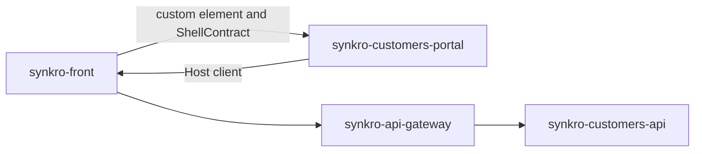

# synkro-customers-portal

> Angular Customers portal mounted as a custom element by the React Host.

Part of the **SynkroTech SAS Sales Management System**. Architecture, decisions and
contracts live in [synkro-docs](https://github.com/code-corhuila/synkro-docs).

**Quick start:** from this root with Node 22, run `npm ci` and `npm run build`, then load the stable entry through synkro-front. See [Getting started](#getting-started).

## What it does

- Provides listing, bounded search, idempotent registration, detail and contact editing.
- Logically deactivates customers and exposes ADMIN reactivation.
- Receives ShellContract v1 through a property and uses the Host's HTTP/session boundary.
- Builds a stable remoteEntry.js that loads the hashed Angular bundle.

## Where it fits



The Angular custom element does not create a second authentication or HTTP client. The Host owns browser navigation and the authenticated transport.

## Tech stack

| Component | Choice |
|---|---|
| Framework | Angular 21; strict TypeScript; zoneless |
| Build | Angular CLI; stable-entry script |
| Test tooling | Vitest; oxlint; isolated Pact consumer contracts |
| Runtime | NGINX static remote; dist/customers/browser |

## Dependencies

| Depends on | Purpose | Configuration |
|---|---|---|
| synkro-front | ShellContract, session, transport and navigation | Host-provided custom-element property |
| synkro-customers-api | Customer operations | Host client through gateway |

## Getting started

From this repository root in **PowerShell or Bash**, using Node 22:

```text
npm ci
npm run build
```

The output is `dist/customers/browser`. Load its stable entry through the Host to obtain session and transport. A standalone Angular dev page does not provision the Host contract.

For the complete platform, start from [synkro-infra-postgres](https://github.com/code-corhuila/synkro-infra-postgres).

## Configuration

The committed [.env.example](.env.example) is the configuration inventory.
Its values are examples; required inputs and defaults follow its comments and the
owning implementation. Keep real secrets in protected local files.

| Variable | Purpose |
|---|---|
| `VITE_CUSTOMERS_PORTAL_ENTRY` | Connection address, origin or build-time entry point |

VITE_CUSTOMERS_PORTAL_ENTRY is configured on the Host build to locate this portal. It is not a separate API/session setting for the Angular application.

## Interface

| Host route | Screen / access |
|---|---|
| /customers | Listing/search; ADMIN and SALESPERSON |
| /customers/new | Registration |
| /customers/:id | Detail and ADMIN reactivation when applicable |
| /customers/:id/edit | Contact/name editing |

The registered element is `synkro-customers-portal`. The Host supplies shellContract v1; incompatible contract versions produce a controlled boundary failure.

## Project structure

```text
src/            Angular customer UI and shell adapter
scripts/        stable entry, boundary and browser acceptance
deploy/         internal NGINX service
tests/pact/     isolated contract tooling
docs/           design, delivery and real-service evidence
```

## Testing

```text
npm run lint
npm run typecheck
npm run coverage
node --test scripts/*.test.mjs
npm run build
npm run test:contract
```

`node scripts/acceptance.mjs` is a separate real-service browser scenario with owned disposable resources. Consumer mock verification is not provider/database acceptance.

## Branching and contributing

Use a `feat/`, `fix/` or `chore/` child branch and a PR into `develop`.
Permanent branches are `develop`, `qa` and `main`; none accepts direct commits.
Promote through a `qa-<description>` or release child with `git cherry-pick -x`.
`main` requires approval from `ariel5253`. Use English Conventional Commits.
See [Git conventions](https://github.com/code-corhuila/synkro-docs/blob/main/00-governance/git-conventions.md).

## Further documentation

- [Portal integration](docs/portal-integration.md).
- [Domain rules](https://github.com/code-corhuila/synkro-docs/blob/main/02-domain/entities-and-rules.md), [contracts](https://github.com/code-corhuila/synkro-docs/tree/main/07-api/contracts/openapi) and [testing strategy](https://github.com/code-corhuila/synkro-docs/blob/main/11-quality/testing-strategy.md).

<!-- Preserve previously published README section links. -->
<a id="branching"></a>
<a id="customers-portal--hu-cli-04"></a>
<a id="consumer-contract-verification"></a>
